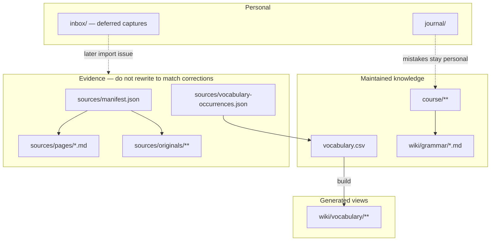
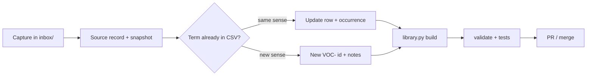
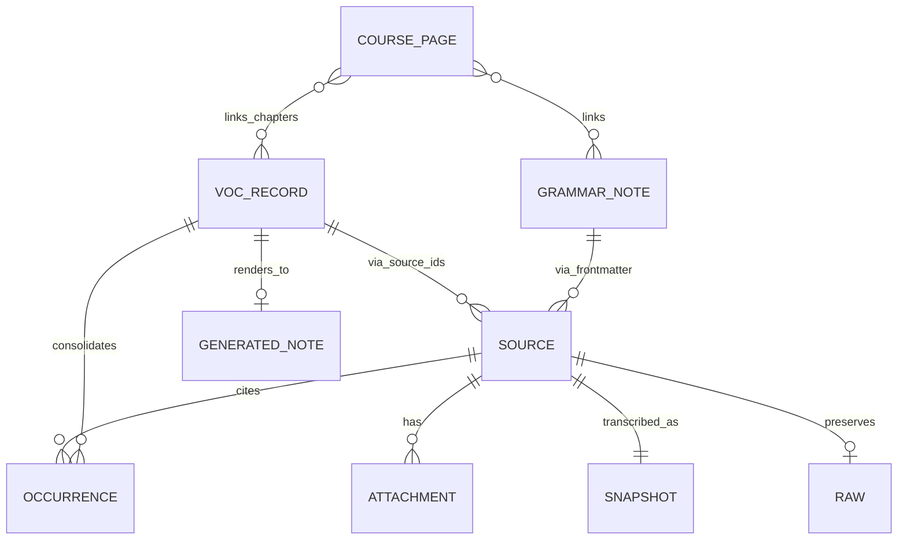
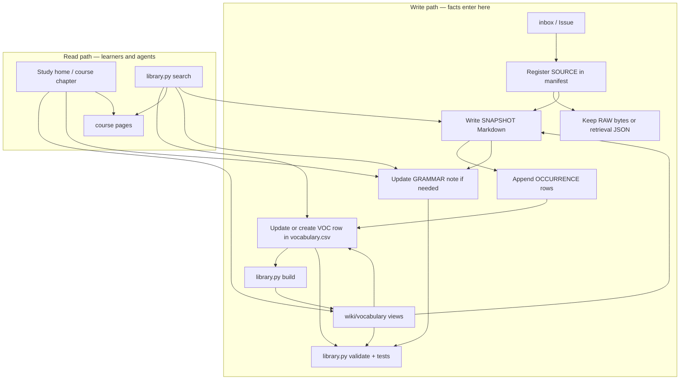
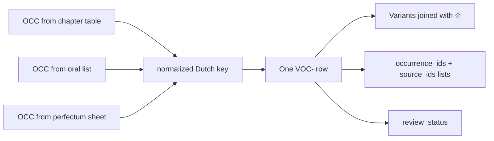
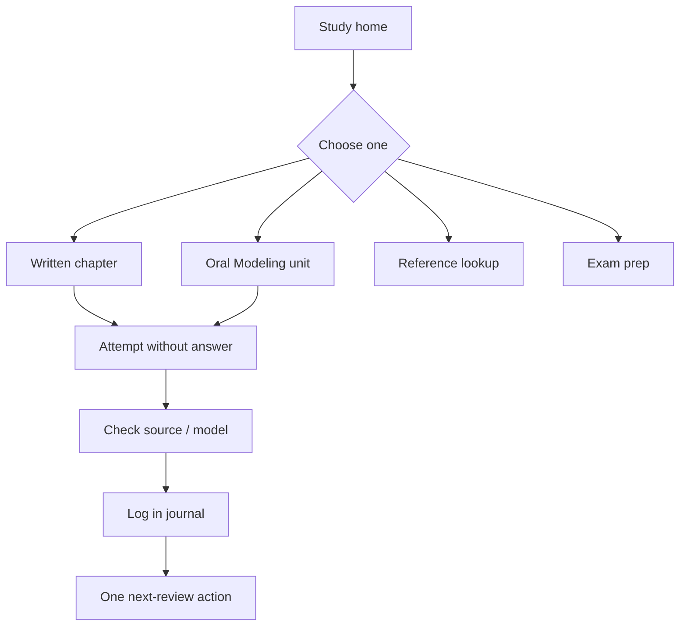

# Repository overview

How this vault is structured, what is authoritative, and the live status as of **2026-10-23** (Europe/Brussels). Prefer this page for orientation; keep [INVENTORY.md](INVENTORY.md) for refreshable counts.

[Home](../README.md) · [Study home](../journal/my-study-view.md) · [Handoff](HANDOFF.md) · [Workflow](../WORKFLOW.md) · [Agents](../AGENTS.md)

---

## What this is

`dutch-study` is a **canonical Dutch study library** that doubles as an **Obsidian vault**. One clone serves GitHub, Obsidian, and agents.

| Role | Location |
| --- | --- |
| Learn | [course/](../course/README.md), [wiki/](../wiki/README.md), [journal/my-study-view.md](../journal/my-study-view.md) |
| Edit facts | [vocabulary.csv](../vocabulary.csv), [wiki/grammar/](../wiki/grammar/README.md) |
| Prove facts | [sources/](../sources/README.md) (manifest, snapshots, originals) |
| Capture later | [inbox/](../inbox/README.md) |
| Automate | [scripts/library.py](../scripts/library.py), CI *Library checks* |

The repository is **public**. Do not commit course passwords or private drafts. The agenda PDF was withheld for that reason; use the [study-safe agenda](../sources/pages/agenda-sept-okt-26.md).

---

## Architecture



**Ownership rule:** correct a fact in the maintained layer; keep the original wording in evidence. Summaries (review sheets, cheat sheets) must follow CSV/grammar — they add no new facts (mark constructed examples with †).



---

## Data architecture and information flow

Column-level rules live in [DATA-SCHEMA.md](DATA-SCHEMA.md). This section is the **system model**: entities, who writes them, and how data moves.

### Entities



| Entity | Store | ID shape | Written by |
| --- | --- | --- | --- |
| **Source** | `sources/manifest.json` → `pages` | Notion page id or `SRC-…` | Import / curator |
| **Raw payload** | `sources/notion/*.json` or notice/binary path | path on disk | Import (immutable thereafter) |
| **Snapshot** | `sources/pages/*.md` | same as source id | Import / transcription |
| **Attachment** | `manifest.json` → `attachments` | filename + status | Import / archival |
| **Occurrence** | `sources/vocabulary-occurrences.json` | `OCC-` + 16 hex | Import; append-only for new evidence |
| **Vocabulary record** | `vocabulary.csv` | `VOC-` + 12 hex (hash of normalized Dutch) | Curator / controlled reconciliation |
| **Generated word/list view** | `wiki/vocabulary/**` | derived from `VOC-` | `library.py build` only |
| **Grammar note** | `wiki/grammar/*.md` | `GRAM-…` in YAML | Curator |
| **Course / summary pages** | `course/**`, cheat sheets, review sheets | path | Curator (summaries must not invent facts) |

**Cardinality that matters:** many occurrences → one vocabulary row (exact normalized term). One row lists many `occurrence_ids` and `source_ids`. Validation requires every listed OCC/SRC to exist and to point back at that row.

### Write vs read paths



| Direction | Allowed | Forbidden |
| --- | --- | --- |
| Evidence → maintained | Consolidate into CSV/grammar with notes | Silently drop conflicting source values |
| Maintained → generated | `build` regenerates views | Hand-edit `wiki/vocabulary/` |
| Maintained → summaries | Update cheat/review sheets after CSV/grammar change | Invent facts only in a summary |
| Maintained → evidence | Never | Rewrite snapshots/images so they “match” a correction |

### Vocabulary consolidation flow



- **Same sense, same normalized string** → one row; differing field values stay visible (` ⟐ `).
- **Different sense** → new id via `record_id(term + ' | ' + sense_label)`; explain in `notes`.
- **Spelling fix** → keep the same `VOC-` id; do not mint a new hash id.
- **`[added]` English** → translation not attested in course evidence; stays `needs-review` until a human accepts it.

### Provenance join (how to audit one word)

1. Open the generated note or CSV row → read `id`, `occurrence_ids`, `source_ids`.
2. Look up each `OCC-…` in `vocabulary-occurrences.json` → `locator`, source-local fields (`dutch`, `english`, `example`, …).
3. Look up each source in `manifest.json` → `snapshot_path` / `raw_path` / attachments.
4. Compare snapshot wording to CSV; if they disagree, CSV is the maintained claim and the snapshot remains the evidence.

### What validation proves

`library.py validate` checks structural integrity of this graph (schema width, id shapes, OCC↔VOC links, known sources, generated freshness, archived hashes/format, grammar frontmatter, relative links). It does **not** prove linguistic correctness or that a snapshot matches a screenshot.

---

## How to study (short loop)



Start at [journal/my-study-view.md](../journal/my-study-view.md). Keep personal errors in the journal; open a GitHub Issue only when a **shared** course fact is wrong.

---

## Live status (2026-10-23)

| Area | Status | Detail |
| --- | --- | --- |
| GitHub Issues | **None open** | Starters #1–#5 closed; see [TASKS.md](TASKS.md) |
| Vocabulary | **520** rows | **501** reviewed · **19** needs-review (`[added]` English) |
| Blank English | **0** | All rows have a gloss; 19 are labeled `[added]` |
| Grammar topics | **14 / 14** reviewed | AI/course-snapshot review — not teacher-certified |
| Oral screenshots | **26 archived** | Hashes checked |
| Notion originals | **41 unavailable** (24 names) | [UNAVAILABLE.md](../sources/originals/UNAVAILABLE.md) |
| Agenda PDF | **withheld-public** | [Transcription](../sources/pages/agenda-sept-okt-26.md) |
| Oral snapshot | **Enriched** | Not page-faithful everywhere; see clothing pp. 90–91 note |
| Inbox class notes | **Deferred** | [Capture](../inbox/2026-10-23-class-notes-schriftelijk.md) — process later |
| CI | Green on recent merges | `python scripts/library.py validate` + 26 unit tests |

### Vocabulary by written chapter

A record may belong to more than one chapter; do not sum these as unique totals. **191** records have no written chapter (oral-only / general).

| Ch | Records | Ch | Records |
| --- | ---: | --- | ---: |
| 1 | 62 | 5 | 65 |
| 2 | 54 | 6 | 39 |
| 3 | 7 | 7 | 30 |
| 4 | 64 | 8 | 21 |

Chapter 3’s short list is expected: it reuses verbs/phrases from other chapters.

### Trust caveats

1. **`reviewed` ≠ textbook-page proof** for oral-enriched material until a faithful re-transcription exists.
2. **Cheat sheets / review sheets** can drift; CSV and grammar notes win conflicts.
3. **Public history** may still contain the old agenda PDF; do not re-add credential-bearing binaries.
4. **AI review** of grammar/vocabulary is recorded in notes and [VERIFICATION.md](VERIFICATION.md); it is not a native-speaker or teacher sign-off.

---

## Folder map

| Path | Edit? | Purpose |
| --- | --- | --- |
| `vocabulary.csv` | Yes | Canonical lexicon |
| `wiki/grammar/` | Yes | Canonical explanations |
| `course/` | Yes | Study order, exercises, oral, exams |
| `wiki/vocabulary/` | No — regenerate | Reading views from CSV |
| `wiki/cheat-sheets/`, `course/review/` | Yes, carefully | Summaries of CSV/grammar only |
| `sources/` | Append evidence; never “fix” snapshots to match CSV | Provenance |
| `journal/` | Yes | Personal attempts |
| `inbox/` | Yes | Deferred / unprocessed captures |
| `scripts/`, `tests/` | Yes | Build, validate, search |

---

## Commands

```bash
python scripts/library.py search vergeten          # vocabulary
python scripts/library.py search --all vergeten    # course, grammar, journal, inbox
python scripts/library.py search --sources term    # also source snapshots
python scripts/library.py build
python scripts/library.py validate
python -m unittest discover -s tests -v
```

On Windows use `py` if needed. Obsidian study needs no Python.

---

## Related docs

| Doc | Use when |
| --- | --- |
| [HANDOFF.md](HANDOFF.md) | Starting a new agent or human session |
| [INVENTORY.md](INVENTORY.md) | Refreshing counts |
| [DATA-SCHEMA.md](DATA-SCHEMA.md) | Adding vocabulary or sources |
| [MIGRATION.md](MIGRATION.md) | Historical Notion import baseline only |
| [VERIFICATION.md](VERIFICATION.md) | What automated checks do and do not prove |
| [SETUP.md](SETUP.md) | Desktop Obsidian + Git |
| [AGENTS.md](../AGENTS.md) | Rules for automated edits |
