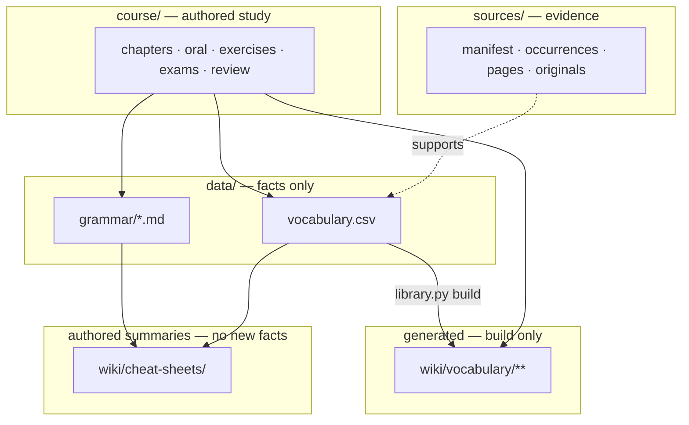
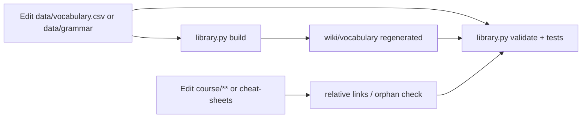

# Soft Data Course Views Layer Split - Plan

## Goal Capsule

- **Objective:** Maintainers and agents can tell where facts live, where study narrative lives, and what is build-only, so edits stay consistent and GitHub remains the primary surface.
- **Means:** Soft same-repo folder split — move canonical facts under `data/`, keep `course/` as authored study, keep generated vocab under `wiki/vocabulary/` this PR with clearer ownership docs (KTD2, KTD3).
- **Authority:** Product Contract Key Decisions and Requirements over Planning Contract KTDs; KTDs over unit approach; Verification Contract over ad-hoc checks.
- **Stop when:** Paths, `library.py`, tests, and orientation docs match the layer table; `python -m unittest discover -s tests -v` and `python scripts/library.py validate` pass; no `.obsidian/` or Obsidian packaging restored.
- **Out of scope for this goal:** Obsidian vault packaging; splitting into multiple git repos; renaming `wiki/vocabulary/` → `views/vocabulary/`; moving cheat-sheets or `course/review/`.
- **Execution profile:** code — feature branch off latest `main` after PR #25 (Obsidian removal) merges, or rebase that tip onto `main` first.
- **Who finishes:** implementer via `ce-work` (or equivalent) opens the PR; human merges.

## Product Contract

### Summary

Make the existing ownership rules visible in the filesystem: facts under `data/`, authored study under `course/`, generated reading views under a documented generated path, with scripts and docs updated so GitHub-first use stays coherent.

### Problem Frame

Canonical facts (`vocabulary.csv`, `wiki/grammar/`) sit beside generated `wiki/vocabulary/` and authored summaries inside one `wiki/` tree, so agents and humans sometimes edit the wrong layer. Obsidian packaging was removed; the next consistency win is a soft layer split in this same repository, not a second vault or second repo.

### Key Decisions

- Obsidian / `.obsidian/` stay removed; no Obsidian packaging in this work. *(session-settled: user-directed — chosen over keep whole-repo Obsidian vault: remove Obsidian and figure it out on GitHub first.)* Governs R6.
- Soft layers stay in one git repository. *(session-settled: user-approved — chosen over separate data + course repositories: one clone, relative links, agents.)* Governs R1, R7.
- Facts change only in the data layer; generated views are build-only; course is authored narrative/practice. *(session-settled: user-approved — chosen over inventing facts in summaries or hand-editing generated vocab: existing OVERVIEW ownership rules.)* Governs R2, R3, R4, R5.

### Requirements

#### Layer ownership

- R1. The repository remains a single clone with relative Markdown links across layers.
- R2. Canonical vocabulary lives at `data/vocabulary.csv` (moved from repo-root `vocabulary.csv`).
- R3. Canonical grammar notes live at `data/grammar/*.md` (moved from `wiki/grammar/`).
- R4. Generated vocabulary reading views remain under `wiki/vocabulary/**` and are produced only by `python scripts/library.py build`.
- R5. `course/` stays the authored study path (chapters, oral, exercises, exams, review sheets); it does not become the store of lexicon or grammar facts.
- R6. This work must not restore `.obsidian/`, create a `vault/` Obsidian package, or reintroduce Obsidian-required config.

#### Tooling and docs

- R7. `scripts/library.py` path constants, build relative links, validate, and search cover the new locations; CI Library checks stay green.
- R8. Orientation docs (`AGENTS.md`, `README.md`, `WORKFLOW.md`, `docs/OVERVIEW.md`, `docs/HANDOFF.md`, `docs/SETUP.md`, `docs/DATA-SCHEMA.md`, `wiki/README.md`, and related indexes) describe the three soft layers and edit rules.
- R9. Hand-written summaries (`wiki/cheat-sheets/`, `course/review/`) stay where they are; docs state they summarize data-layer facts and add no new facts (constructed examples marked †).

### Success Criteria

- A new contributor reading `docs/OVERVIEW.md` can name which directory to edit for a vocabulary fact, a grammar note, a chapter guide, and a generated word page.
- `validate` fails on hand-edited or stale generated vocab the same way it does today.
- Search `--all` still finds grammar and course content after the move.

### Scope Boundaries

#### In scope

- `git mv` of `vocabulary.csv` → `data/vocabulary.csv` and `wiki/grammar/` → `data/grammar/`
- Path updates in `scripts/library.py`, `tests/`, orientation docs, and relative links in maintained Markdown (including `sources/pages/` link targets when they point at moved paths)
- Regenerating `wiki/vocabulary/**` via `build` so committed views match new CSV relative links
- Ownership / layer diagrams in orientation docs

#### Deferred to Follow-Up Work

- Rename `wiki/vocabulary/` → `views/vocabulary/` (or top-level `views/`) once data-layer move is stable
- Optional future Obsidian *export* vault packaging (explicitly not this work)
- Moving cheat-sheets or review sheets into another folder

#### Outside this product's identity

- Splitting into two git repositories
- Restoring whole-repo Obsidian as the primary surface
- Changing VOC-/GRAM- ID schemes, CSV columns, or occurrence ledger shape
- Processing deferred inbox captures

### Assumptions

- PR #25 (`cursor/remove-obsidian-30a6`) lands on `main` (or the implementer rebases onto that tip) before or as the base of the layer-split branch, so docs are already GitHub-first and `.obsidian/` is absent.
- Keeping generated vocab at `wiki/vocabulary/` for this PR is acceptable; clarity comes from docs plus moving facts out of `wiki/grammar/` and root CSV.
- `scripts/import_notion.py` remains a frozen one-time utility; update only the refuse-overwrite path check if needed so it still protects `data/vocabulary.csv`, without re-running import against the maintained library.
- Link rewrites inside `sources/pages/` snapshots adjust path targets only; snapshot body text is otherwise preserved.

## Planning Contract

### Key Technical Decisions

- KTD1. Soft layer names are `data/` (facts), `course/` (authored study), and generated views at `wiki/vocabulary/` for this PR. *(session-settled product decisions on one-repo soft layers and ownership map to R1–R5; this KTD picks the concrete paths.)* Chosen over leaving CSV at repo root with docs-only layering: the request prefers moving CSV + grammar into `data/`.
- KTD2. Do not rename `wiki/vocabulary/` → `views/vocabulary/` in this PR. Chosen over doing both moves together: grammar/CSV moves already force wide link rewrites; deferring the views rename shrinks review risk while ownership docs close the confusion gap. Deferred rename is Follow-Up Work.
- KTD3. Leave `wiki/cheat-sheets/` and `course/review/` in place; strengthen ownership wording only. Chosen over relocating summaries into `data/` or `course/` only: they are authored summaries, not facts, and moving them is optional polish.
- KTD4. Centralize path constants in `scripts/library.py` (`DATA_CSV`, `GRAMMAR_DIR`, `VIEWS`, search `TEXT_DIRS`) and regenerate views rather than hand-editing the generated tree. Mirrors the existing `VIEWS = 'wiki/vocabulary'` pattern and CHANGELOG migration that moved `views/` → `wiki/vocabulary/`.
- KTD5. Implementation branch: `cursor/<descriptive>-…` off latest `main` after #25, or rebase #25 tip then branch. Chosen over stacking silently on an unmerged Obsidian-removal tip without noting the dependency.

**Bake-off not run:** folder-name vs docs-only and views-rename timing were open areas, but the request already preferred `data/` for facts and allowed either views path; KTD1–KTD2 resolve them by judgment without competing mechanisms that need further development.

### High-Level Technical Design

#### Target layer map



#### Write vs generate



#### Output Structure

```text
data/
  vocabulary.csv          # was ./vocabulary.csv
  grammar/                # was wiki/grammar/
    README.md
    *.md
course/                   # unchanged role
wiki/
  vocabulary/             # still generated
  cheat-sheets/           # stay; docs clarify
  README.md               # index updated — grammar lives under data/
scripts/library.py        # path constants + link depths
```

### Implementation Constraints

- Python 3.11+ stdlib only for library scripts; no new dependencies.
- Prefer `git mv` so history follows.
- After CSV moves, always `build` and commit regenerated views with the path change.
- Do not hand-edit `wiki/vocabulary/**`.
- Do not rewrite snapshot narrative to “match” CSV; only fix relative link targets when paths move.
- Never restore `.obsidian/`.

### Sequencing

1. Branch from post-#25 `main` (U1).
2. Add path constants + characterization tests (U2).
3. Move files and rewrite links (U3).
4. Update orientation docs (U4).
5. Full validate + CI parity (U5).

### Risks and Dependencies

| Risk | Mitigation |
| --- | --- |
| Broken relative links / orphan pages after grammar move | `validate` link + orphan checks; rewrite course/wiki/journal/docs links in the same commit as `git mv` |
| Generated views still point at old `../../vocabulary.csv` depth | Regenerate via `build`; assert fixture paths in tests |
| Stacking on unmerged #25 | KTD5 — base on merged `main` or rebase first |
| Agents keep editing root `vocabulary.csv` | AGENTS.md + OVERVIEW + README path table; optional stub note only if needed (prefer clean move, no stub file) |
| `import_notion.py` path drift | Leave frozen except refuse path for `data/vocabulary.csv`; do not re-run import |

### Sources and Research

- Live ownership model: `docs/OVERVIEW.md` (architecture, wiki vs course, write vs read paths).
- Prior folder migration pattern: `CHANGELOG.md` (chapters→course, grammar/views→wiki).
- Path constants and validate behavior: `scripts/library.py` (`VIEWS`, `_grammar_frontmatter_errors`, orphan glob, `TEXT_DIRS`).
- Fixture expectations: `tests/test_library.py` (`CorpusFixture`, stale-generated, unexpected file).
- Handoff already lists optional later `data/` layering: `docs/HANDOFF.md` — this plan implements the soft data split without the Obsidian `vault/` half.
- PR #25: Obsidian removal, GitHub-first tip `cursor/remove-obsidian-30a6`.

## Implementation Units

### U1. Branch and base hygiene

- **Goal:** Start from a GitHub-first tree without Obsidian config.
- **Requirements:** R6; KTD5
- **Dependencies:** None
- **Files:** none (git only)
- **Approach:**
  1. Ensure `main` includes PR #25, or rebase `cursor/remove-obsidian-30a6` onto `main` then branch.
  2. Create feature branch `cursor/soft-layer-split-<id>` (Cloud Agents: suffix per environment rules).
  3. Confirm `.obsidian/` is absent before content moves.
- **Test scenarios:**
  - Test expectation: none -- branch setup only; verified by tree inspection before U3.
- **Verification:** `test ! -d .obsidian`; branch tracks intended base.

### U2. Path constants and characterization tests

- **Goal:** Lock new path contracts in code and tests before moving files.
- **Requirements:** R2, R3, R4, R7; KTD1, KTD4
- **Dependencies:** U1
- **Files:** `scripts/library.py`, `tests/test_library.py`
- **Approach:**
  1. Introduce named constants for CSV path, grammar dir, and views dir (views stay `wiki/vocabulary`).
  2. Point `read_rows`, `_csv_width_errors`, `_grammar_frontmatter_errors`, orphan checks, and `TEXT_DIRS` at the new locations.
  3. Update generated page link depths to `data/vocabulary.csv` and preserve links to `course/` and `sources/`.
  4. Update `CorpusFixture` and assertions that hardcode `vocabulary.csv` or `wiki/vocabulary/...` keys.
- **Execution note:** Write failing fixture assertions for `data/vocabulary.csv` and grammar under `data/grammar/` first, then flip constants — characterization before the bulk `git mv`.
- **Patterns to follow:** Existing `VIEWS = 'wiki/vocabulary'`; fixture pattern in `CorpusFixture`.
- **Test scenarios:**
  - Happy path: fixture with `data/vocabulary.csv` + `data/grammar/topic.md` builds views under `wiki/vocabulary/` and `validate` returns no errors.
  - Edge: changing CSV without rebuild yields `stale generated file` errors.
  - Edge: unexpected file under views dir still reported.
  - Error: grammar note missing frontmatter / bad `review_status` still fails via `_grammar_frontmatter_errors` on `data/grammar/`.
  - Integration: `search --all` includes hits from `data/grammar` (via updated `TEXT_DIRS`).
- **Verification:** `python -m unittest discover -s tests -v` green for updated fixtures (may use temp trees only until U3 moves the corpus).

### U3. Move facts and rewrite links

- **Goal:** Place canonical facts under `data/` and keep the repo link-complete.
- **Requirements:** R1, R2, R3, R4, R5, R7; KTD1, KTD4
- **Dependencies:** U2
- **Files:** `data/vocabulary.csv`, `data/grammar/**`, `wiki/grammar/` (removed), root `vocabulary.csv` (removed), maintained Markdown under `course/`, `wiki/`, `journal/`, `docs/`, `README.md`, `AGENTS.md`, `WORKFLOW.md`, `START-HERE.md`, link targets in `sources/pages/**` as needed, `scripts/import_notion.py` (refuse path only), regenerated `wiki/vocabulary/**`
- **Approach:**
  1. `git mv vocabulary.csv data/vocabulary.csv`; `git mv wiki/grammar data/grammar`.
  2. Rewrite relative links to the new paths (course → `../data/grammar/...`, wiki README, journal, docs).
  3. Run `python scripts/library.py build` and commit regenerated views with corrected CSV link depths.
  4. Update orphan validation globs already pointed at `data/grammar` in U2.
  5. Adjust `import_notion.py` existence check to `data/vocabulary.csv` only; do not re-run import.
- **Patterns to follow:** CHANGELOG migration that rewrote links when moving into `wiki/`.
- **Test scenarios:**
  - Happy path: full-tree `validate` returns `[]` / exit 0 after move + build.
  - Integration: chapter guide link to a grammar note resolves; generated word page links to `data/vocabulary.csv`.
  - Edge: `wiki/grammar/` no longer exists; no dangling references in maintained files (`rg wiki/grammar` clean except historical CHANGELOG/MIGRATION if intentionally left).
  - Error: hand-editing a generated word file still fails validate freshness.
- **Verification:** `python scripts/library.py validate`; `rg -n 'wiki/grammar' --glob '!CHANGELOG.md' --glob '!docs/MIGRATION.md' --glob '!docs/plans/**'` empty (or only deliberate historical mentions).

### U4. Orientation docs for soft layers

- **Goal:** GitHub-first docs state the three layers and edit rules without Obsidian packaging.
- **Requirements:** R5, R6, R8, R9; KTD2, KTD3
- **Dependencies:** U3
- **Files:** `docs/OVERVIEW.md`, `docs/HANDOFF.md`, `docs/SETUP.md`, `docs/DATA-SCHEMA.md`, `docs/INVENTORY.md` (paths/counts refresh if needed), `AGENTS.md`, `README.md`, `WORKFLOW.md`, `START-HERE.md`, `wiki/README.md`, `course/README.md` as needed
- **Approach:**
  1. Replace path tables and mermaid diagrams so facts show under `data/`, course under `course/`, generated under `wiki/vocabulary/`.
  2. State explicitly that cheat-sheets and review sheets stay put and remain non-authoritative for new facts.
  3. Update HANDOFF “do next” so layering is no longer “optional later data/ + vault/” — data soft-split done or in PR; Obsidian export still deferred.
  4. Do not document a `vault/` layout.
- **Test scenarios:**
  - Test expectation: none -- documentation; verified by link check via `validate` and manual scan of orientation entry points.
- **Verification:** `validate` still green; OVERVIEW layer table matches on-disk layout.

### U5. CI parity and regression sweep

- **Goal:** Prove Library checks and agent search paths match the new layout.
- **Requirements:** R7, R8
- **Dependencies:** U3, U4
- **Files:** `.github/workflows/library-checks.yml` (only if commands need path changes — prefer no workflow edit), `tests/test_publish.py` if it assumes old paths
- **Approach:**
  1. Run unittest + validate locally.
  2. Grep for stale `vocabulary.csv` at repo root and `wiki/grammar` in active docs/scripts/tests.
  3. Confirm workflow still runs the same two commands.
- **Test scenarios:**
  - Happy path: unittest discover and validate both exit 0.
  - Integration: `python scripts/library.py search --all perfectum` returns hits including a `data/grammar/` path.
- **Verification:** Same commands as CI; PR shows green Library checks.

## Verification Contract

Primary gates (must match CI):

```bash
python -m unittest discover -s tests -v
python scripts/library.py validate
```

Additional checks for this refactor:

```bash
test ! -d .obsidian
test -f data/vocabulary.csv
test -d data/grammar
test ! -e vocabulary.csv
test ! -d wiki/grammar
python scripts/library.py search --all "aan het" | head
```

No `release:validate` or behavioral skill eval applies — content library, not an app server.

## Definition of Done

- [ ] All Implementation Units U1–U5 complete
- [ ] R1–R9 satisfied; session-settled decisions honored (no Obsidian restore, one repo, facts-only in data)
- [ ] Verification Contract commands pass locally and on PR CI
- [ ] Regenerated `wiki/vocabulary/**` committed with the move
- [ ] Orientation docs describe soft layers; HANDOFF no longer points “next” at Obsidian vault packaging as the layering step
- [ ] Abandoned experiments (half-moved paths, stub CSV at root) removed from the diff
- [ ] PR opened against `main` describing the layer table and explicitly excluding Obsidian/`vault/`

### Per-unit done

| Unit | Done when |
| --- | --- |
| U1 | Feature branch on post-#25 base; no `.obsidian/` |
| U2 | Constants + fixture tests encode `data/` + `wiki/vocabulary` contracts |
| U3 | Facts live under `data/`; validate clean; views rebuilt |
| U4 | OVERVIEW/AGENTS/README/HANDOFF/SETUP/DATA-SCHEMA match layout |
| U5 | CI-equivalent commands green; stale path grep clean for active files |
