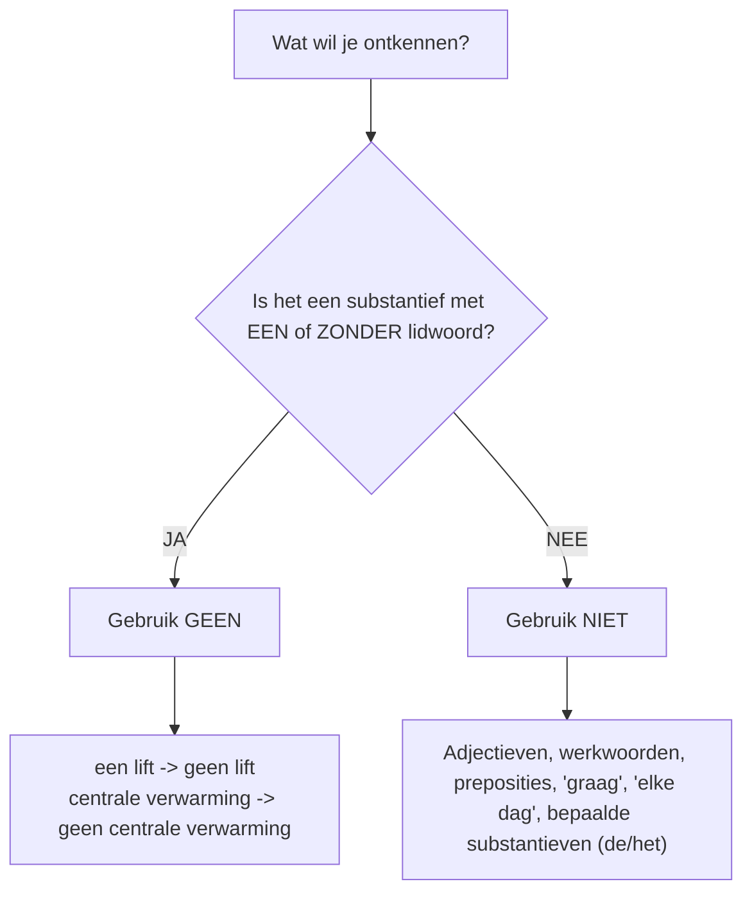

# Master grammar reference

> Preserved import snapshot, 2026-10-23. Not maintained as canonical study data.

[Original Notion page](https://app.notion.com/p/401f89e5e0fc810ba4aff82d2143b580?pvs=204) · [Exact retrieval payload](../notion/401f89e5e0fc810ba4aff82d2143b580.json)

Imported from Grammar\_Master\_[Reference.md](http://Reference.md). Section navigation is in English; the original Dutch explanations, rules and examples are preserved.

## 1. Grammar by chapter

| # | Onderwerp | Hoofdstuk | Ook relevant in | Toepassing / Functie |
| --- | --- | --- | --- | --- |
| **H3** | **Modale verba** (*kunnen, moeten, mogen, willen*) | H3 *Wat moet ik doen?* | H6 (verzoeken/afspraken) | Vermogen, verplichting, toelating, wens |
| **H4** | **Nevenschikking** (*want, en, maar, of*) | H4 *Hoe ziet het app. eruit?* | H6 (berichten/motivering) | Twee hoofdzinnen verbinden zonder inversie |
| **H4** | **Er als voorlopig subject** | H4 *Hoe ziet het app. eruit?* | H5 *Mijn favoriete kamer* | Onbepaald onderwerp introduceren |
| **H4** | **Negatie** (*geen* vs. *niet*) | H4 *Hoe ziet het app. eruit?* | Alle hoofdstukken | Ontkenning van substantieven, werkwoorden, preposities |
| **H5** | **Het adjectief** (met/zonder *-e*) | H5 *Mijn favoriete kamer* | H1 (*Wie is wie?*), H7 | Bijvoeglijk naamwoord voor/na substantief |
| **H8** | **Vergelijken** (*even...als, -er dan, -st*) | H8 *Wie is de kampioen?* | H4 (woningvergelijking) | Gelijkheid, comparatief, superlatief |
| **H2** | **Perfectum, inversie & gaan + inf.** | H2 *Heb je een leuke citytrip gehad?* | H7 (verloren voorwerpen) | Verleden tijd, chronologische zinsbouw |
| **H6** | **Omdat / bijzin & zal (futurum)** | H6 *Heb je mijn bericht al gelezen?* | E-mails & afwezigheid | Bijzinwoordvolgorde (SOV) & beloftes |
| **H1** | **Stappenplan schrijven** | H1 *Wie is wie?* | Alle schrijfopdrachten | Doelgroep, tekstdoel, register, controle |

---

## 2. Modal verbs + infinitive

> **Zinsstructuur:** `Subject` + `Modaal Verbum (vervoegd op positie 2)` + `...` + `Infinitief (helemaal achteraan)`.

### Vervoegingstabel (Presens)

| Persoon | kunnen | moeten | mogen | willen |
| --- | --- | --- | --- | --- |
| **ik** | kan | moet | mag | wil |
| **jij / je** | kan / kunt | moet | mag | wil / wilt |
| **u** *(beleefd)* | kan / kunt | moet | mag | wil / wilt |
| **hij / zij (ze) / het** | kan | moet | mag | wil |
| **wij / we** | kunnen | moeten | mogen | willen |
| **jullie** | kunnen | moeten | mogen | willen |
| **zij / ze** *(meervoud)* | kunnen | moeten | mogen | willen |

### Betekenissen & Voorbeelden

| Verbum | Betekenis / Functie | Praktijkvoorbeeld |
| --- | --- | --- |
| **kunnen** | **Vaardigheid / bekwaamheid** | *Mijn dochter ****kan**** goed zwemmen.* |
| **kunnen** | **Mogelijkheid / optie** | *Je ****kan**** je oude kleding in een zak op straat zetten.* |
| **moeten** | **Noodzaak** | *Maria krijgt bezoek. Ze ****moet**** boodschappen doen.* |
| **moeten** | **Verplichting / gebod** | *Het verkeerslicht is rood, je ****moet**** stoppen.* |
| **mogen** | **Toelating / permissie** | *Het licht is groen, je ****mag**** oversteken.* |
| **niet mogen** | **Verbod** | *Je ****mag**** hier niet parkeren.* |
| **willen** | **Wens / intentie** | *Maria ****wil**** naar het buurtfeest gaan.* |

---

## 3. Joining main clauses: want, en, maar, of

> **Regel:** Na de nevenschikkende voegwoorden verandert de woordvolgorde van de zin **niet**.
**Structuur:** `Hoofdzin 1` + `,` + `Voegwoord` + `Subject` + `Verbum` + `Rest`.

| Voegwoord | Relatie / Betekenis | Modelvoorbeeld |
| --- | --- | --- |
| **want** | **Reden** *(Waarom?)* | *Wij gaan verhuizen, ****want**** ons appartement is te klein.* |
| **en** | **Toevoeging / opsomming** | *We hebben een ruime woonkamer ****en**** we hebben nu 3 slaapkamers.* |
| **maar** | **Tegenstelling / restrictie** | *Wij wonen ver van het werk, ****maar**** we hebben een auto.* |
| **of** | **Keuze / alternatief** | *Blijven we thuis ****of**** gaan we naar zee?* |

---

## 4. Giving reasons: want vs. omdat

**Cruciaal verschil in zinsbouw tussen Hoofdzin en Bijzin:**

- **want** = nevenschikking ➔ normale woordvolgorde (`want` + `S` + `V` + `...`)
- **omdat** = onderschikking ➔ bijzin / verba achteraan (`omdat` + `S` + `...` + `V`)

| Constructie | Type zin | Woordvolgorde | Voorbeeldzin |
| --- | --- | --- | --- |
| **... want ...** | Hoofdzin + Hoofdzin | `want`  • **Subject**  • **Verbum**  • Rest | *Ik kan niet komen, ****want ik ben**** ziek.* |
| **... omdat ...** | Hoofdzin + Bijzin | `omdat`  • **Subject**  • Rest + **Verbum** | *Ik kan niet komen, ****omdat ik**** ziek ****ben****.* |
| **... omdat ... (perfectum)** | Hoofdzin + Bijzin | `omdat`  • **Subject**  • Rest + **Hulpww. + Participle** | *Luiz was verdrietig, ****omdat hij zijn knuffel vergeten had****.* |

---

## 5. Introducing something with er

> **Wanneer gebruiken?**
Als het echte onderwerp (subject) **niet specifiek / onbepaald** is en verderop in de zin staat, begint de zin met **`Er`** (zeer courant bij woning- en kamerbeschrijvingen).

### Voorwaarden voor het subject:

- Met een onbepaald lidwoord: **`een`** (*Er is een lift.*)
- Met het ontkennend lidwoord: **`geen`** (*Er is geen berging.*)
- Zonder lidwoord / stofnaam: (*Er is centrale verwarming.*)
- Met een telwoord of hoeveelheid: (*Er zijn twee slaapkamers. / Er staan veel kasten.*)

| Type Onderwerp | Structuur | Voorbeeldzin |
| --- | --- | --- |
| **Enkelvoud (****`is`****)** | Er + is + onbepaald subst. | *Er is een badkamer met douche.* |
| **Meervoud (****`zijn`****)** | Er + zijn + telwoord / mv. subst. | *Er zijn twee ruime slaapkamers.* |
| **Positieverbum** | Er + staat / ligt / hangt + subst. | *Er hangt een schilderij aan de muur.* |
| **Negatie** | Er + is/zijn + geen + subst. | *Er is geen autostaanplaats bij het gebouw.* |

---

## 6. Negation: geen vs. niet

| Type Ontkenning | Regel | Bevestigend | Ontkennend (Negatie) |
| --- | --- | --- | --- |
| **Substantief met ****`een`** | `een`  • subst. ➔ **geen** | *Er is een lift.* | *Er is ****geen**** lift.* |
| **Substantief zonder lidwoord** | ∅ + subst. ➔ **geen** | *Er is centrale verwarming.* | *Er is ****geen**** centrale verwarming.* |
| **Vóór ****`graag`****, ****`elke dag`** | Vóór adverbium ➔ **niet** | *Ik woon graag in het centrum.* | *Ik woon ****niet graag**** in het centrum.* |
|  |  | *Ik neem elke dag de bus.* | *Ik neem ****niet elke dag**** de bus.* |
| **Vóór een prepositie** | Vóór voorzetsel ➔ **niet** | *Ik woon op de 3e verdieping.* | *Ik woon ****niet**** op de 3e verdieping.* |
| **Verbum / Algemeen** | Achteraan / na verbum ➔ **niet** | *Hij begrijpt het woord.* | *Hij begrijpt het woord ****niet****.* |
| **Bepaald substantief (****`de`****/****`het`****)** | Vóór het bepaalde subst. ➔ **niet** | *Hij betaalt de factuur.* | *Hij betaalt ****niet**** de factuur.* |

---

## 7. Adjective endings

### Positie 1: Na het substantief (predicatief, na *zijn / worden / lijken*)

- ➔ **NOOIT EEN ****`-e`**!
- *De tafel is ****rond****.*
- *De stoelen zijn ****nieuw****.*
- *Het appartement is ****duur****.*

---

### Positie 2: Vóór het substantief (attributief)

Kijk naar het lidwoord en het type woord:

| Substantief Type | Lidwoord / Context | Uitgang | Voorbeeld |
| --- | --- | --- | --- |
| **DE-woord** (enkelvoud) | met `de`, `een`, `mijn`, ∅ | **  • -e** | *de ****ronde**** tafel*, *een ****nieuwe**** bloes*, *een ****gele**** broek* |
| **HET-woord** (bepaald) | met `het`, `dit`, `dat`, `mijn` | **  • -e** | *het ****witte**** T-shirt*, *het ****nieuwe**** bed*, *mijn ****grote**** huis* |
| **HET-woord** (onbepaald) | met **`een`** of **geen** (∅) | **GEEN -e** | *een ****rond**** tapijt*, *een ****nieuw**** appartement*, *een ****groot**** bed* |
| **Meervoud** (alle woorden) | met `de`, `geen`, telwoord, ∅ | **  • -e** | *de ****nieuwe**** stoelen*, *twee ****kleine**** kamers*, *ronde tafels* |

---

### Positie 3: Uitzonderingen — Adjectieven die NOOIT `-e` krijgen

1. **Adjectieven die eindigen op ****`-en`**:

- *het ****effen**** tapijt*, *een ****open**** deur*.

2. **Stoffelijke adjectieven** (materialen, meestal eindigend op `-en`):

- *de ****houten**** stoel*, *de ****glazen**** salontafel*, *de ****lederen / leren**** driezit*, *de ****stoffen**** zetel*, *het ****ijzeren**** bed*, *de ****wollen**** vest*, *het ****katoenen**** T-shirt*.
- *Uitzondering plastic:* blijft onveranderd: *de ****plastic**** stoel*.

3. **Adjectieven die reeds eindigen op een onbeklemtoonde ****`-e`**:

- *de ****roze**** zetel*, *het ****oranje**** tapijt*.

---

## 8. Comparatives and superlatives

### Formules:

- **Gelijkheid (=):** `even` + **adjectief** + `als`  *(even duur als)*
- **Comparatief (>):** **adjectief + ****`-er`** + `dan` *(duurder dan)*
- **Superlatief (MAX):** `het` + **adjectief + ****`-st(e)`** *(het duurst / de duurste)*

---

### 1. Regelmatige Adjectieven

| Basisvorm | Gelijkheid (=) | Comparatief (+er dan) | Superlatief (de/het ...-ste) | Opmerking / Spelling |
| --- | --- | --- | --- | --- |
| **oud** | even oud als | oud**er** dan | de/het oud**ste** | Standaard |
| **ruim** | even ruim als | ruim**er** dan | de/het ruim**ste** | Standaard |
| **groot** | even groot als | gro**ter** dan | de/het groot**ste** | Klinkerverdubbeling / t-reductie |
| **klein** | even klein als | klein**er** dan | de/het klein**ste** | Standaard |
| **kort** | even kort als | kort**er** dan | de/het kort**ste** | Standaard |
| **duur** *(op -r)* | even duur als | duur**der** dan | de/het duur**ste** | **-d- tussenvoeging na r** |
| **zwaar** *(op -r)* | even zwaar als | zwaar**der** dan | de/het zwaar**ste** | **-d- tussenvoeging na r** |
| **ver** *(op -r)* | even ver als | ver**der** dan | de/het ver**ste** | **-d- tussenvoeging na r** |

---

### 2. Onregelmatige Adjectieven & Adverbia

| Basisvorm | Gelijkheid (=) | Comparatief | Superlatief | Modelvoorbeeld |
| --- | --- | --- | --- | --- |
| **goed** | even goed als | **beter** dan | het **best** / de **beste** | *Het nieuwe appartement is ****beter**** dan het oude.* |
| **veel** | even veel als | **meer** dan | het **meest** / de **meeste** | *We hebben ****meer**** slaapkamers dan vroeger.* |
| **weinig** | even weinig als | **minder** dan | het **minst** / de **minste** | *Er is in deze straat ****minder**** lawaai.* |
| **graag** | even graag als | **liever** dan | het **liefst** | *Ik drink ****liever**** thee dan koffie.* |

---

## 9. Perfectum, inversion and future

### A. Het Perfectum (Voltooid Tegenwoordige Tijd)

> **Formule:** `Subject` + `hulpverbum (hebben/zijn vervoegd op pos. 2)` + `Rest` + `Participle / Ge-vorm (achteraan)`.

- **Met ****`hebben`****:** De meeste transitieve werkwoorden (*hebben gemaakt, gekocht, gezien*).
- **Met ****`zijn`****:** Werkwoorden van beweging met richting of verandering van toestand (*zijn gegaan, vertrokken, gekomen, gebleven, gestorven, opgestaan*).

### B. Inversie met Tijdssignaalwoorden (*Eerst, Daarna, Dan*)

> Normale zin: `Subject` + `Verbum` + `Rest` (*Ik ga eerst koffie drinken.*)
**Inversiezin:** `Tijdselement` + `Verbum` + `Subject` + `Rest`

| Signaalwoord | Positie 1 | Positie 2 (Verbum) | Positie 3 (Subject) | Rest van de zin |
| --- | --- | --- | --- | --- |
| **Eerst** | *Eerst* | **bezoeken** | we | het museum in het centrum. |
| **Daarna** | *Daarna* | **eten** | we | een Luikse wafel op de markt. |
| **Dan** | *Dan* | **nemen** | we | de trein terug naar huis. |

### C. Toekomst / Belofte met *Zullen* (Futurum)

> **Formule:** `Subject` + `zal / zullen` + `Rest` + `Infinitief`.

- *Ik ****zal**** wat later ****zijn****, want de trein heeft vertraging.*
- *Ik ****zal**** de leerkracht een e-mail ****sturen****.*
- *Dat ****zal**** ik ****doen****!*

---

## 10. Writing checklist

### 4 Vaste Stappen voor Schrijfopdrachten:

1. **Analyseer de opdracht:**

- **Voor wie?** Bekend (vriend, collega ➔ *je / jij*) vs. Onbekend / formeel (directeur, administratie ➔ *u / uw*).
- **Waarom?** Informatie vragen, informatie geven, verontschuldigen, uitnodigen, beschrijven.
- **Wat voor tekst?** E-mail, WhatsApp-bericht, websiteforum, verloren voorwerpen formulier.

2. **Raadpleeg het tips-kader:** Zinslengte, tijden, hoofdletters en specifieke constructies (*Er is/zijn*, *positiewerkwoorden*).
3. **Schrijf een kladversie:** Let op correcte woordvolgorde (`S-V-Rest` of inversie).
4. **Zelfcontrole (Checklist):**

- [ ] Begint elke zin met een **hoofdletter**?
- [ ] Eindigt elke zin met een **leesteken** (`.` / `?` / `!`)?
- [ ] Heeft elke zin een expliciet **subject** en een **verbum**?
- [ ] Hebben eigennamen, steden, talen en landen een hoofdletter?
- [ ] Is het adjectief correct verbogen (met of zonder `-e`)?
- [ ] Zijn preposities en lidwoorden (`de` / `het`) correct?

---

## 11. Irregular verbs

| # | Infinitief | Perfectum | Type Hulpwerkwoord |
| --- | --- | --- | --- |
| 1 | aandoen | (hebben) aangedaan | hebben |
| 2 | aankomen | (zijn) aangekomen | **zijn** |
| 3 | afspreken | (hebben) afgesproken | hebben |
| 4 | afwassen | (hebben) afgewassen | hebben |
| 5 | bakken | (hebben) gebakken | hebben |
| 6 | beginnen | (zijn) begonnen | **zijn** |
| 7 | begrijpen | (hebben) begrepen | hebben |
| 8 | bevallen | (zijn) bevallen | **zijn** |
| 9 | bezoeken | (hebben) bezocht | hebben |
| 10 | blijven | (zijn) gebleven | **zijn** |
| 11 | brengen | (hebben) gebracht | hebben |
| 12 | doen | (hebben) gedaan | hebben |
| 13 | dragen | (hebben) gedragen | hebben |
| 14 | drinken | (hebben) gedronken | hebben |
| 15 | eruitzien | (hebben) eruitgezien | hebben |
| 16 | eten | (hebben) gegeten | hebben |
| 17 | gaan | (zijn) gegaan | **zijn** |
| 18 | hangen | (hebben) gehangen | hebben |
| 19 | hebben | (hebben) gehad | hebben |
| 20 | helpen | (hebben) geholpen | hebben |
| 21 | innemen | (hebben) ingenomen | hebben |
| 22 | kiezen | (hebben) gekozen | hebben |
| 23 | kijken | (hebben) gekeken | hebben |
| 24 | klimmen | (hebben/zijn) geklommen | hebben / **zijn** |
| 25 | komen | (zijn) gekomen | **zijn** |
| 26 | kopen | (hebben) gekocht | hebben |
| 27 | krijgen | (hebben) gekregen | hebben |
| 28 | kunnen | (hebben) gekund | hebben |
| 29 | lezen | (hebben) gelezen | hebben |
| 30 | liggen | (hebben) gelegen | hebben |
| 31 | lopen | (hebben/zijn) gelopen | hebben / **zijn** |
| 32 | meebrengen | (hebben) meegebracht | hebben |
| 33 | meegaan | (zijn) meegegaan | **zijn** |
| 34 | meenemen | (hebben) meegenomen | hebben |
| 35 | moeten | (hebben) gemoeten | hebben |
| 36 | mogen | (hebben) gemogen | hebben |
| 37 | nemen | (hebben) genomen | hebben |
| 38 | ontbijten | (hebben) ontbeten | hebben |
| 39 | onthouden | (hebben) onthouden | hebben |
| 40 | opstaan | (zijn) opgestaan | **zijn** |
| 41 | rijden | (hebben/zijn) gereden | hebben / **zijn** |
| 42 | schrijven | (hebben) geschreven | hebben |
| 43 | scheiden | (zijn) gescheiden | **zijn** |
| 44 | slapen | (hebben) geslapen | hebben |
| 45 | snijden | (hebben) gesneden | hebben |
| 46 | spreken | (hebben) gesproken | hebben |
| 47 | staan | (hebben) gestaan | hebben |
| 48 | sterven | (zijn) gestorven | **zijn** |
| 49 | teruggeven | (hebben) teruggegeven | hebben |
| 50 | terugkrijgen | (hebben) teruggekregen | hebben |
| 51 | terugvinden | (hebben) teruggevonden | hebben |
| 52 | thuisblijven | (zijn) thuisgebleven | **zijn** |
| 53 | uitdoen | (hebben) uitgedaan | hebben |
| 54 | uitlezen | (hebben) uitgelezen | hebben |
| 55 | vallen | (zijn) gevallen | **zijn** |
| 56 | vergeten | (hebben) vergeten | hebben |
| 57 | verkopen | (hebben) verkocht | hebben |
| 58 | vertrekken | (zijn) vertrokken | **zijn** |
| 59 | vinden | (hebben) gevonden | hebben |
| 60 | wassen | (hebben) gewassen | hebben |
| 61 | weggeven | (hebben) weggegeven | hebben |
| 62 | winnen | (hebben) gewonnen | hebben |
| 63 | zien | (hebben) gezien | hebben |
| 64 | zijn | (zijn) geweest | **zijn** |
| 65 | zingen | (hebben) gezongen | hebben |
| 66 | zitten | (hebben) gezeten | hebben |
| 67 | zoeken | (hebben) gezocht | hebben |
| 68 | zwemmen | (hebben/zijn) gezwommen | hebben / **zijn** |

---
